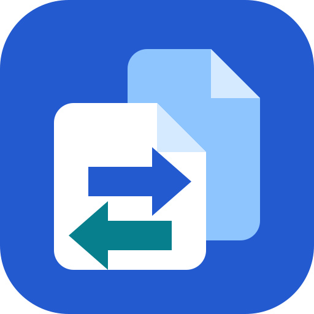
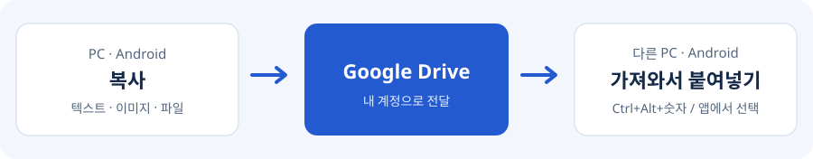

#  Network Copier

**여기서 복사하고, 다른 기기에서 붙여넣기.** Google Drive를 사용하는 PC·Android 공유 앱입니다.

- [Windows 다운로드](https://github.com/JHB-1/network-copier-releases/releases/latest): `network_copier.exe` 하나만 실행
- [Android 다운로드](https://github.com/JHB-1/network-copier-releases/releases/tag/android-current): `network_copier.apk` 설치
- 같은 Google 계정으로 로그인, PC는 `Ctrl+Alt+1`~`9`, Android는 앱에서 가져오기

**0.1.0은 이전 ClipBridge와 분리된 새 앱입니다.** 이전 설정·로그인은 가져오지 않으며 기존 앱·자료는 삭제하지 않습니다.
클립 데이터는 종단 간 암호화되지 않습니다. Windows 실행 파일은 Authenticode 미서명으로 경고가 나올 수 있습니다.

업데이트 메타데이터는 서명 검증하며, Qt LGPL 원본·재링크 자료는 릴리스의 별도 압축 파일로 제공합니다.
